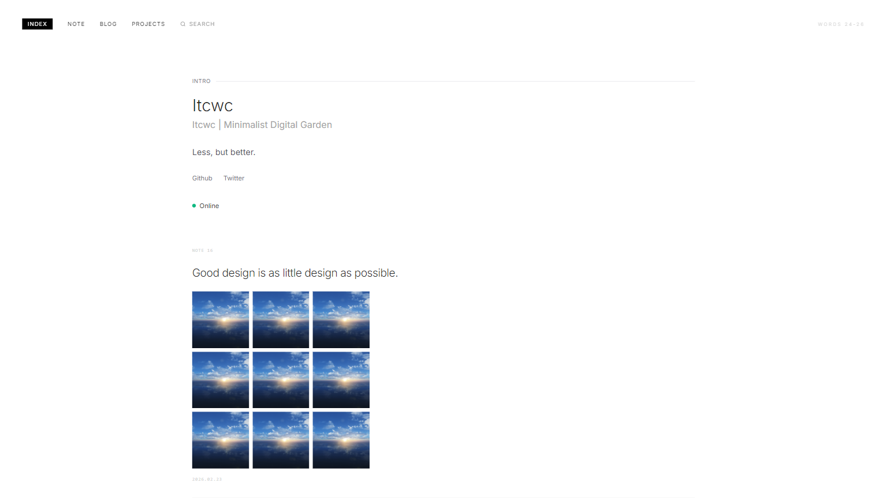
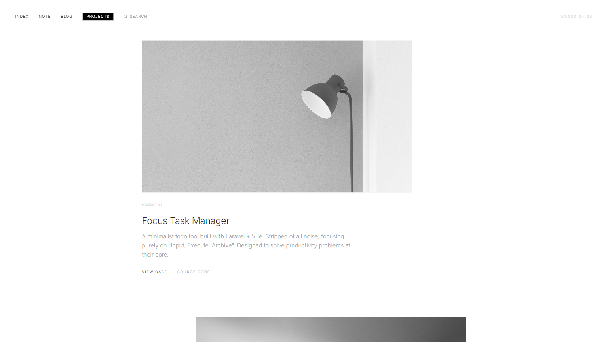
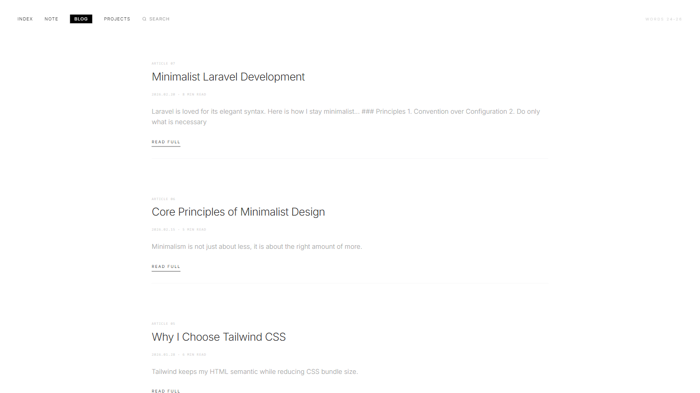
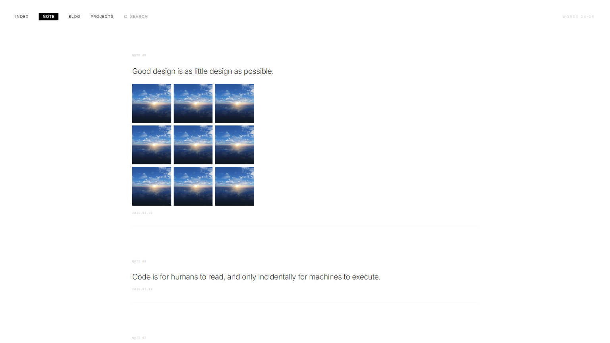
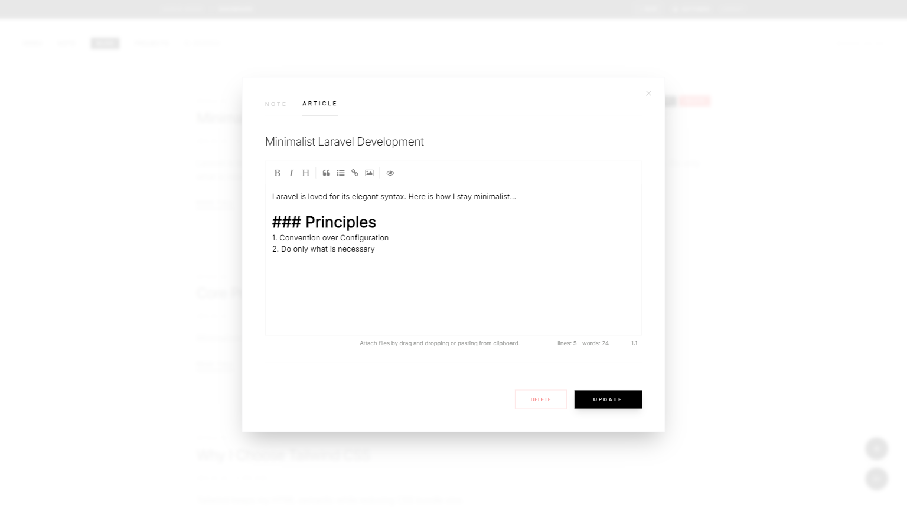
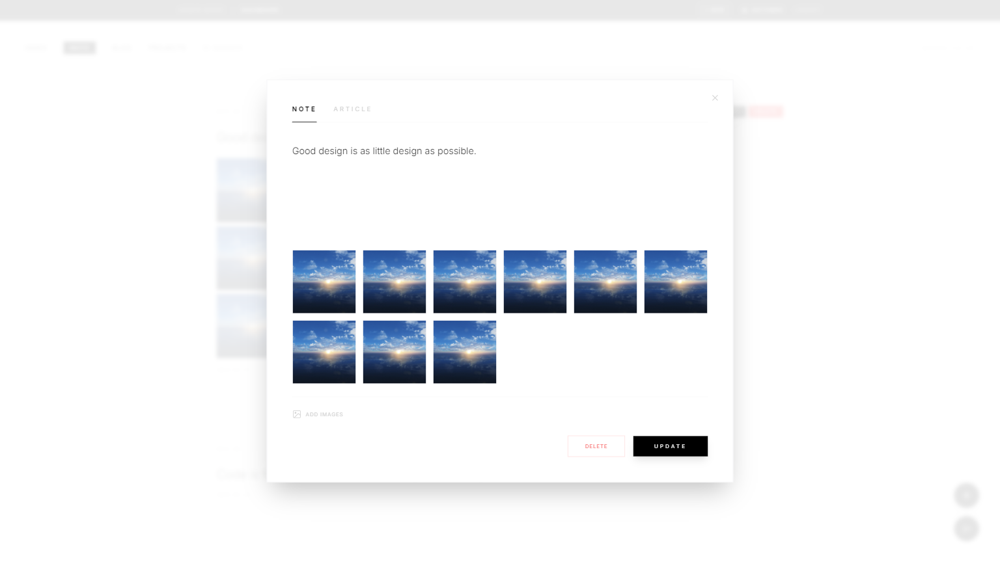
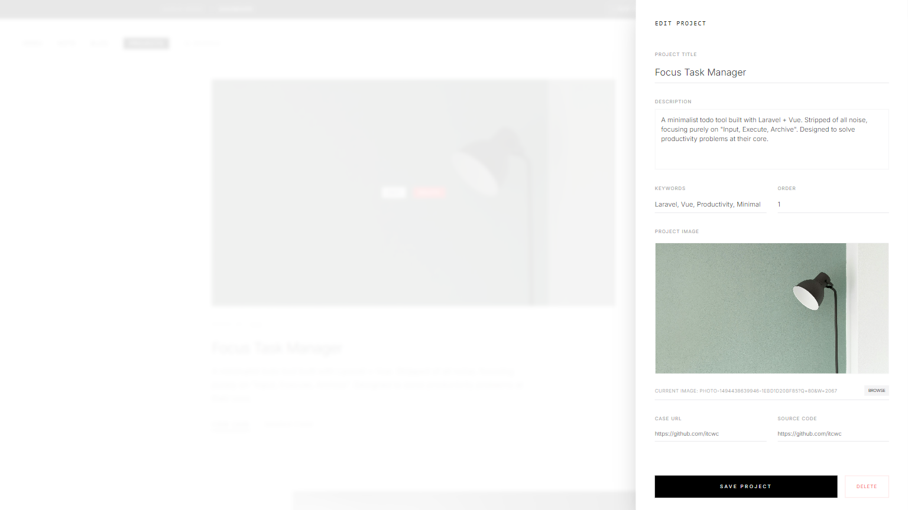
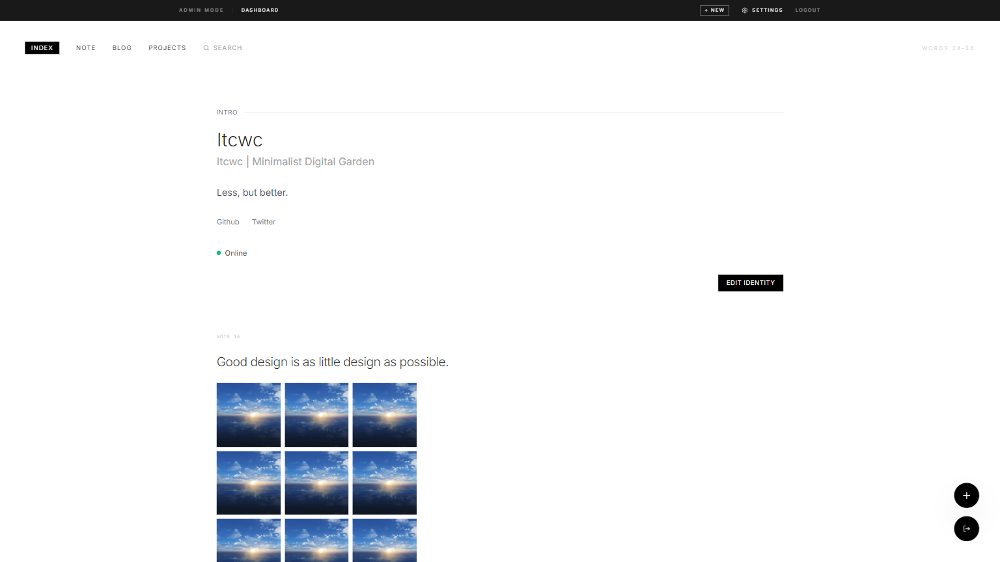

# Digital Garden

[](https://laravel.com)
[](LICENSE)
[](https://github.com/itcwc/itcwc-laravel-blog/issues)

> A minimalist **personal digital garden** built with Laravel 12 — for publishing and showcasing your **projects, notes, and blog posts** from a single, clean system.

**[中文文档](README_CN.md)**

## ✨ Features

- 📝 **Multi-content types** — manage Projects, Notes, and Blog posts in one place.
- 🖊 **Markdown authoring** — write with the EasyMDE editor; content is parsed by `league/commonmark` and rendered as HTML.
- 🌈 **Code highlighting** — fenced code blocks are highlighted with highlight.js.
- 🌐 **Multi-language (i18n)** — built-in language support with an onboarding language picker.
- 🛠 **Admin panel** — manage blog / notes / projects and global settings.
- 🧙 **Install wizard** — visit `/install` for environment check, DB setup, admin account creation, and language selection.
- ⚡ **Queue-ready** — Redis-backed queue worker for background jobs.
- 🎨 **Modern frontend** — Vite + Tailwind CSS v4 (typography plugin) with a clean, responsive UI.

## 🛠 Tech Stack

| Layer | Technology |
| --- | --- |
| Backend | Laravel 12 (PHP ≥ 8.2) |
| Markdown | `league/commonmark`, EasyMDE |
| Code highlight | highlight.js |
| Database | MySQL ≥ 5.7 |
| Cache / Queue | Redis |
| Frontend build | Vite 7, Tailwind CSS 4 |
| Tooling | Laravel Pint, Sail, Pail, PHPUnit |

## 📸 Screenshots

### Homepage


### Projects


### Blog


### Note


### Admin Panel

#### Blog Management


#### Note Management


#### Project Management


#### Settings


## 📋 Requirements

- PHP >= 8.2
- MySQL >= 5.7
- Redis
- Composer
- Node.js >= 20.19.0
- npm

## 🚀 Installation

### 1. Install Dependencies
```bash
composer install
npm install
```

### 2. Configure Environment
Copy `.env.example` to `.env` and modify the configuration:
```bash
cp .env.example .env
```

### 3. Generate Application Key
```bash
php artisan key:generate
```

### 4. Basic Configuration
Edit the `.env` file and ensure the following settings are correct:
```env
# Queue driver must be set to redis
QUEUE_CONNECTION=redis

# Redis connection
REDIS_HOST=127.0.0.1
REDIS_PASSWORD=null
REDIS_PORT=6379
```

### 5. Start Queue Worker
```bash
php artisan queue:work
```
> It is recommended to use Supervisor to keep the queue process running.

### 6. Run Installation Wizard
Visit the following URL to start the installation:
```
http://your-app.test/install
```
The installation wizard will guide you through:
- Environment check
- Database configuration
- Admin account creation
- Language selection

## 💻 Development
```bash
# Start development server
php artisan serve

# Watch frontend assets
npm run dev
```

## 📄 License
[License: MIT](LICENSE)
