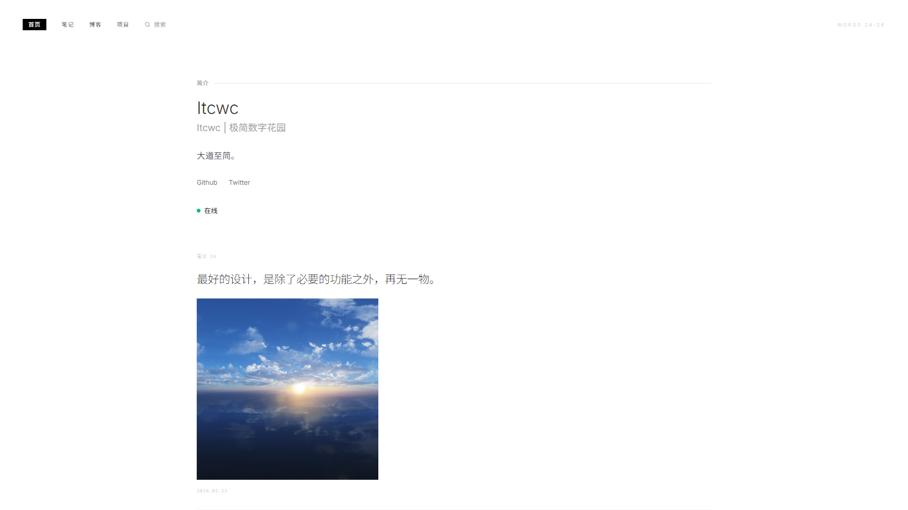
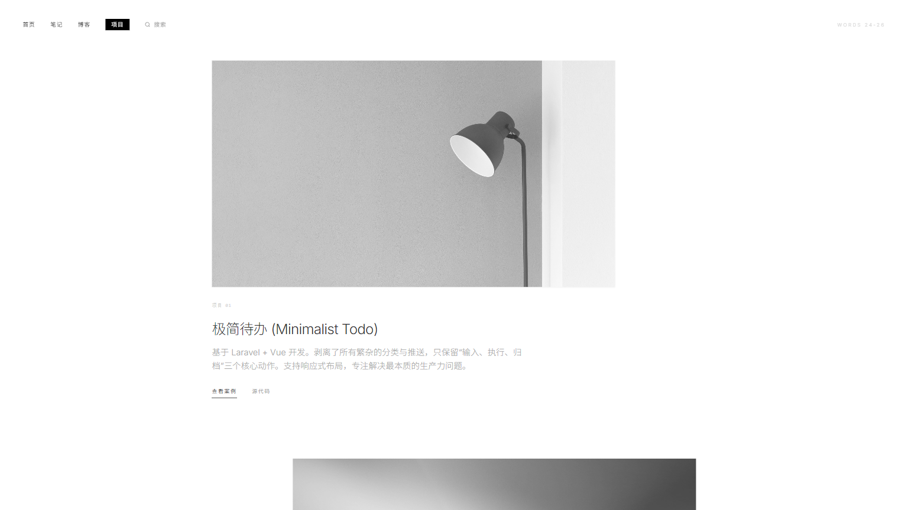
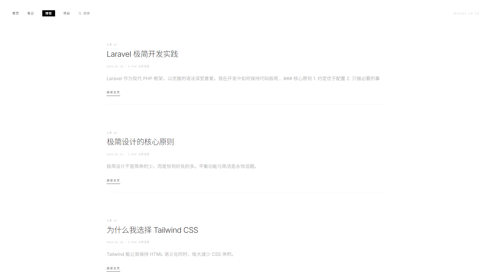
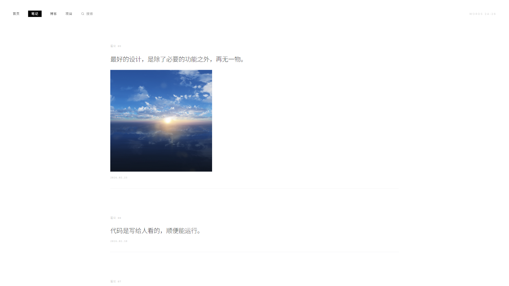
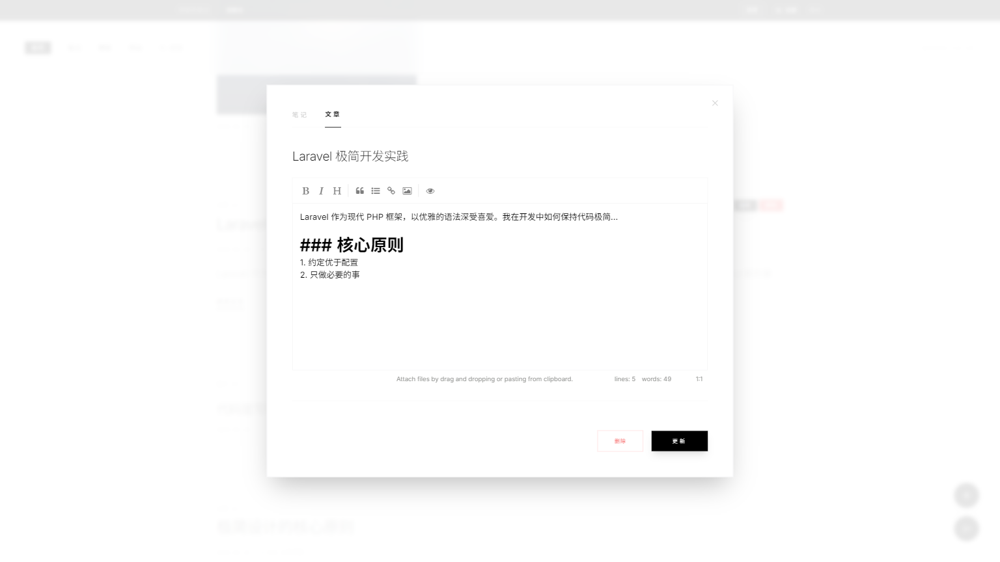
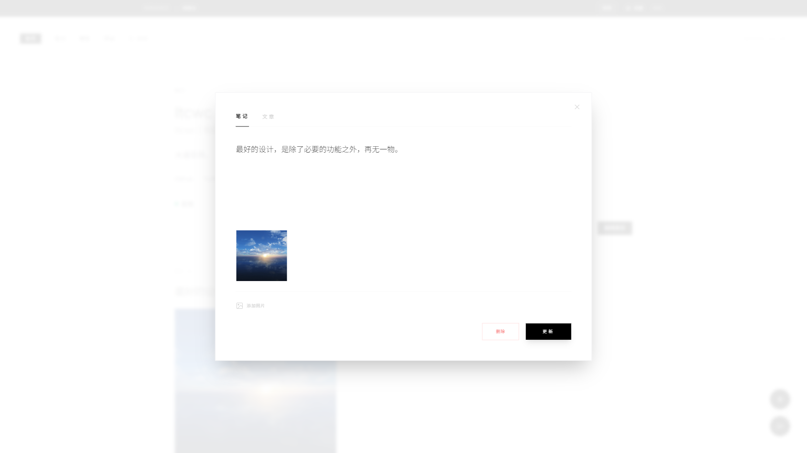
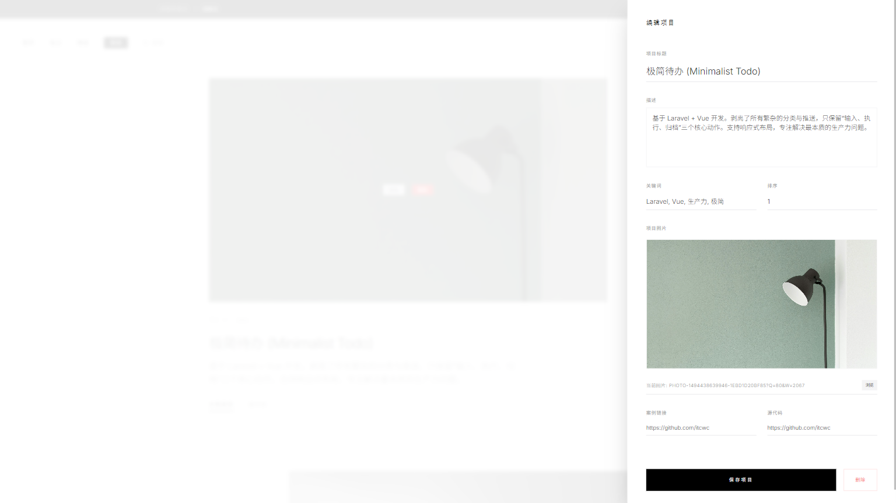
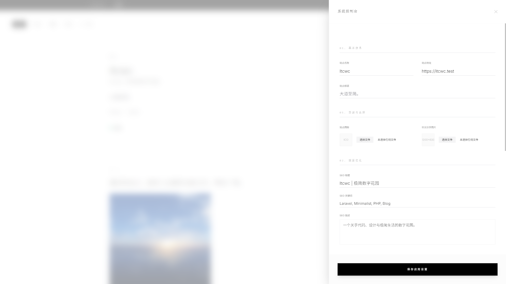

# Digital Garden

[](https://laravel.com)
[](LICENSE)
[](https://github.com/itcwc/itcwc-laravel-blog/issues)

> 一个基于 Laravel 12 构建的极简**个人数字花园**，用一套干净的系統统一发布与展示你的**项目、笔记和博客文章**。

**[English](README.md)**

## ✨ 功能特性

- 📝 **多内容类型** —— 在一个后台统一管理「项目」「笔记」「博客」三类内容。
- 🖊 **Markdown 写作** —— 使用 EasyMDE 编辑器撰写，内容由 `league/commonmark` 解析并渲染为 HTML。
- 🌈 **代码高亮** —— 围栏代码块通过 highlight.js 自动高亮。
- 🌐 **多语言（i18n）** —— 内置语言支持，安装时即可选择语言。
- 🛠 **管理后台** —— 管理博客 / 笔记 / 项目以及全局设置。
- 🧙 **安装向导** —— 访问 `/install` 完成环境检测、数据库配置、管理员账号创建与语言选择。
- ⚡ **队列支持** —— 基于 Redis 的队列工作进程，用于后台任务。
- 🎨 **现代化前端** —— Vite + Tailwind CSS v4（typography 插件），界面简洁且响应式。

## 🛠 技术栈

| 层级 | 技术 |
| --- | --- |
| 后端 | Laravel 12（PHP ≥ 8.2） |
| Markdown | `league/commonmark`、EasyMDE |
| 代码高亮 | highlight.js |
| 数据库 | MySQL ≥ 5.7 |
| 缓存 / 队列 | Redis |
| 前端构建 | Vite 7、Tailwind CSS 4 |
| 开发工具 | Laravel Pint、Sail、Pail、PHPUnit |

## 📸 截图预览

### 首页


### 项目展示


### 博客文章


### 笔记


### 管理后台

#### 博客管理


#### 笔记管理


#### 项目管理


#### 系统设置


## 📋 环境要求

- PHP >= 8.2
- MySQL >= 5.7
- Redis
- Composer
- Node.js >= 20.19.0
- npm

## 🚀 安装步骤

### 1. 安装项目依赖
```bash
composer install
npm install
```

### 2. 配置环境变量
复制 `.env.example` 为 `.env` 并修改配置：
```bash
cp .env.example .env
```

### 3. 生成应用密钥
```bash
php artisan key:generate
```

### 4. 基础配置
编辑 `.env` 文件，确保以下配置正确：
```env
# 队列驱动必须设置为 redis
QUEUE_CONNECTION=redis

# Redis 连接信息
REDIS_HOST=127.0.0.1
REDIS_PASSWORD=null
REDIS_PORT=6379
```

### 5. 启动队列工作进程
```bash
php artisan queue:work
```
> 建议使用 Supervisor 保持队列进程持续运行。

### 6. 执行安装向导
访问以下地址开始安装：
```
http://your-app.test/install
```
安装向导将引导您完成：
- 环境检测
- 数据库配置
- 管理员账号创建
- 语言选择

## 💻 开发

```bash
# 启动开发服务器
php artisan serve

# 监听前端资源变化
npm run dev
```

## 📄 许可证
MIT
